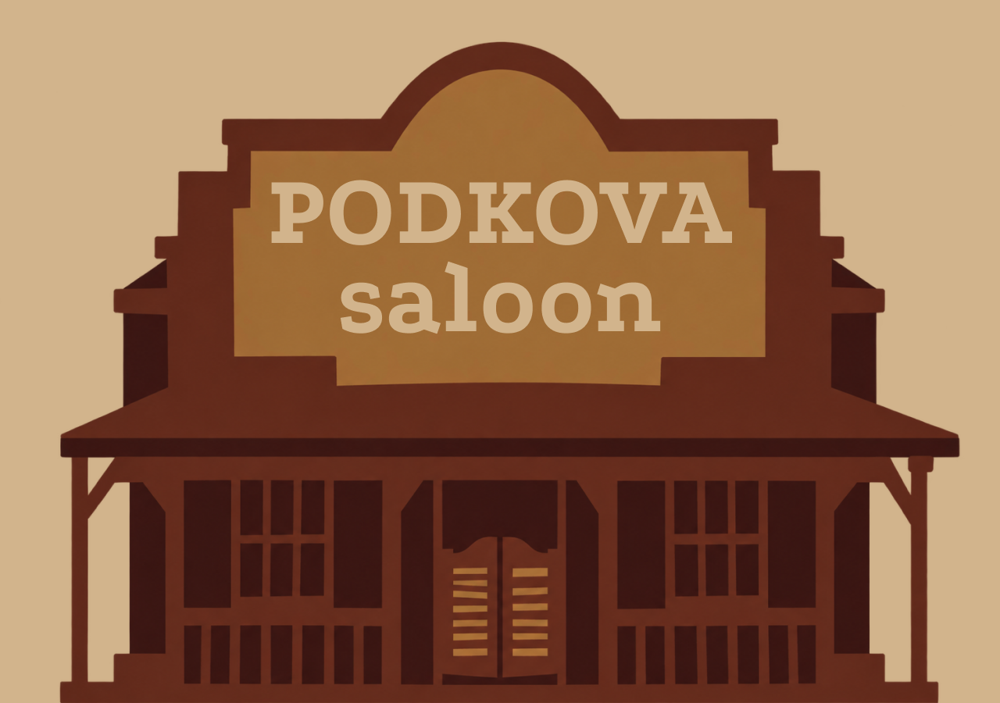

# Podkova

Лонгрид, посвящённый шрифту Podkova. Сайт оформлен в стилистике салуна Дикого Запада: через иллюстрации и композицию блоков он рассказывает об истории шрифта, его создателях, начертаниях, вариативности, цифрах и знаках.

## Ссылка на сайт

https://alina00ww.github.io/Podkova/

## Скриншот

## Автор

Тимохина Алина, БДЗ266

## Что я научился(ась) делать

- 1. научилась собирать сложную композицию из текста и иллюстраций с помощью HTML и CSS.

2. разобралась, как использовать абсолютное позиционирование и отступы для точного размещения элементов относительно друг друга.

3. научилась подключать собственный шрифт через @font-face и настраивать его отображение.

4. разобралась, как работает масштабирование страницы через JavaScript при изменении ширины окна браузера.

## Использование ИИ

### Инструменты

| Инструмент | Для чего использовал(а) | Уровень помощи |
| ---------- | ----------------------- | -------------- |
| Claude Code        | Помог разобраться с отдельными техническими вопросами, связанными с масштабированием страницы и позиционированием элементов в CSS.                     | 2            |

### Записи о запросах

#### Запись №1 · [21.10]

- **Что я хотел(а) сделать:** добиться точного расположения изображений и текстовых элементов внутри секций.
- **Что я спросил(а):** «как лучше организовать позиционирование большого количества элементов в CSS, чтобы при настройке одного элемента не нарушалось расположение остальных?»
- **Что ответил ИИ:** объяснил, как использовать позиционирование относительно родительского блока и почему важно учитывать контекст расположения элементов.
- **Что я изменил(а) сам(а):** корректировала положение отдельных элементов и проверила их расположение относительно соседних блоков.
- **Как я понял(а), что это работает:** открыла страницу в браузере и проверила, соответствует ли все макету.

#### Запись №2 · [21.10]

- **Что я хотел(а) сделать:** настроить расстояния между заголовками и текстом, чтобы сохранить композицию макета.
- **Что я спросил(а):** «как лучше использовать margin для настройки отступов между текстовыми элементами, если некоторые из них должны располагаться ближе друг к другу?»
- **Что ответил ИИ:** объяснил, как свойства margin-top и margin-left влияют на положение элемента и как отрицательные значения могут использоваться для корректировки расстояний.
- **Что я изменил(а) сам(а):** подобрала значения отступов под расположение элементов в макете.
- **Как я понял(а), что это работает:** проверила страницу в браузере и сравнила расстояния между элементами с макетом.

#### Запись №3 · [23.10]

- **Что я хотел(а) сделать:** сохранить пропорции макета при изменении ширины окна браузера.
- **Что я спросил(а):** «как правильно рассчитывать масштаб страницы шириной 1280 пикселей, чтобы её пропорции сохранялись при изменении размера окна?»
- **Что ответил ИИ:** объяснил, как рассчитывать коэффициент масштабирования на основе ширины окна браузера и обновлять его при изменении размера окна.
- **Что я изменил(а) сам(а):** проверила работу скрипта вместе с CSS и подстроила решение под структуру страницы.
- **Как я понял(а), что это работает:** меняла ширину окна браузера и проверяла, сохраняются ли пропорции макета.

### Выводы

во время работы я лучше разобралась в том, как устроена вёрстка сайта с большим количеством текста и изображений. Больше всего внимания пришлось уделить расположению элементов: в моём макете многие детали должны находиться в конкретных местах, поэтому важно было правильно настроить позиционирование и отступы. Также я разобралась, как подключать шрифт Podkova через @font-face и как работает масштабирование страницы через JavaScript, чтобы макет сохранял пропорции при изменении ширины окна браузера. ИИ оказался полезен, когда требовалось разобраться в отдельных технических моментах и понять, как лучше реализовать определённое решение. В итоге я стала лучше ориентироваться в структуре HTML, понимать связь между стилями и расположением элементов.
